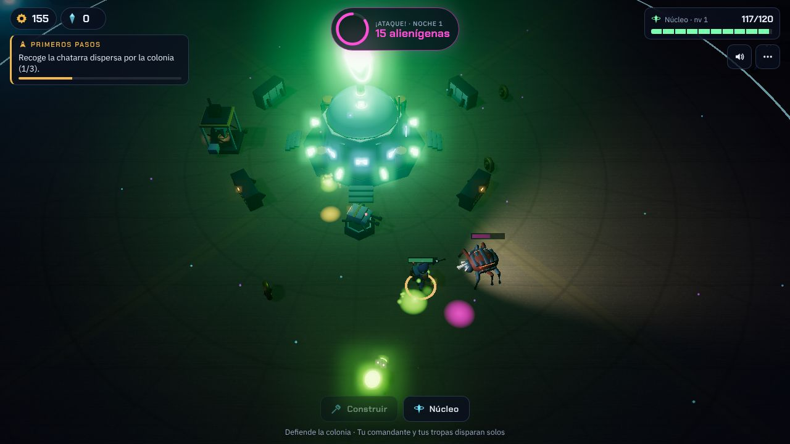

# Colonia Nova · edición Esperanza

Versión principal de Colonia Nova. Parte de la v3 y se centra en los gráficos, las animaciones,
el sonido y la historia.

La nave colonia **Esperanza** se estrella en un planeta desconocido. Los supervivientes levantan una
colonia alrededor de su reactor y, cada noche, las criaturas del planeta atacan atraídas por su calor.
Tras diez noches los colonos terminan de reparar la nave, que despega rumbo al Planeta Rojo: fin del
primer capítulo. La partida sigue después en modo resistencia.



## Qué hay de nuevo respecto a la v3

- **Modelos 3D hechos en Blender** (`assets/kit.glb`, 39 modelos): comandante, soldados, ingenieros y
  colonos; seis alienígenas (bicho, veloz, escupidor, volador, acorazado y reina); los siete edificios y el
  reactor; la nave Esperanza estrellada; cristales, nido, cápsula de escape, rocas, acantilados, flora y
  objetos de la colonia.
- **Animaciones**: correr, reposo y trabajar para los humanos; moverse y atacar para cada alienígena.
- **Historia**: cinemática de introducción (la caída de la nave), mensajes de ARIA, la IA de la nave,
  durante la partida, la reparación de la Esperanza visible en sus luces y el despegue final.
- **Gráficos**: cielo con un planeta gigante con anillos y dos lunas, terreno con dunas, ciclo de día,
  atardecer y noche, sombras, *bloom*, luces de los disparos y explosiones, partículas, humo y manchas en el
  suelo.
- **Sonido**: efectos y música de día y de noche generados en el navegador (no hay archivos de audio).
- **Interfaz** nueva: portada, marcadores con iconos, reloj de día/noche, objetivo actual, panel de ARIA
  y miniaturas de los edificios renderizadas con los modelos reales.
- La partida de la v3 se carga automáticamente.

Las reglas de juego (edificios, mejoras, tropas, oleadas, meteoritos, exploración) son las de la v3.

## Jugar

Necesita un servidor web (los módulos de JavaScript no se cargan desde `file://`):

```bash
cd prototipos/colonia-nova-esperanza
python3 -m http.server 8000      # y abre http://localhost:8000
```

Publicado con GitHub Pages: `https://cubetajjr.github.io/mi-juego-3d/prototipos/colonia-nova-esperanza/`.

Controles: WASD o flechas (en móvil, arrastrar). «Construir» o tecla B. Toca un edificio para mejorarlo.

## Cómo está hecho

| Carpeta | Contenido |
| --- | --- |
| `js/main.js` | reglas del juego, entidades, entrada, cámara y bucle |
| `js/kit.js` | carga del kit de modelos, clones, animaciones y materiales |
| `js/world.js` | terreno, cielo, decorado y la nave estrellada |
| `js/fx.js` | partículas, luces de destello y manchas en el suelo |
| `js/audio.js` | efectos y música sintetizados |
| `js/story.js` | cinemáticas y mensajes de ARIA |
| `tools/blender/` | script que construye todos los modelos en Blender |
| `tools/viewer.html` | visor para revisar modelos y animaciones |
| `vendor/three/` | Three.js r170 (licencia MIT), incluido para que funcione sin internet |

### Regenerar los modelos

```bash
pip install bpy                     # Blender como módulo de Python (Python 3.13)
python tools/blender/build_assets.py assets/kit.glb
```

Los colores de las piezas se guardan como colores de vértice sobre tres materiales compartidos
(mate, metálico y luminoso), así el juego dibuja cada pieza con pocas llamadas a la GPU.

## Estado y límites conocidos

- Rendimiento medido con el renderizador por software del entorno de pruebas (no da FPS reales):
  unas 400 llamadas de dibujo en una noche normal y 540 en una escena muy cargada (14 alienígenas),
  por encima del presupuesto orientativo de 300. En móviles se desactivan las sombras de los personajes.
  El siguiente paso para bajarlo es unir cada personaje en una sola malla con esqueleto.
- Los modelos no llevan texturas pintadas: el detalle viene de la forma, los biseles y los materiales.
- Detalle de las pruebas: [artifacts/final-evidence.md](artifacts/final-evidence.md).
